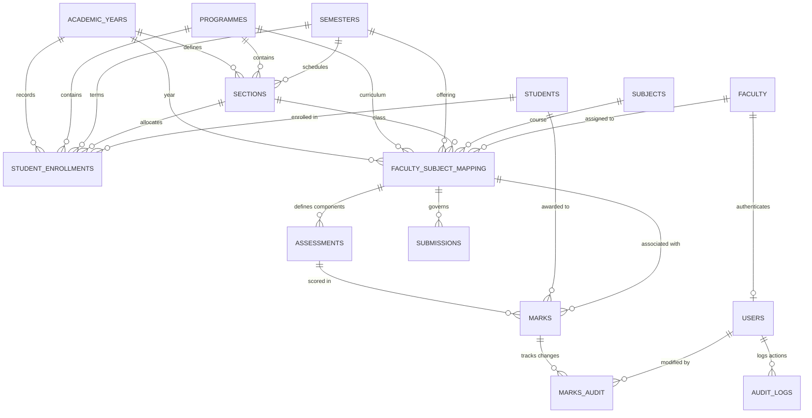

# Academic Assessment Management System (AAMS)
### Faculty Assessment & Student Marks Management System
**Technical Specification & Architecture — Version 1.0 (09 November 2026)**

Built strictly to comply with the **Product Requirements Document (PRD v1.0)** and the **Technical Requirements Document (TRD v1.0)**.

---

## 1. Technical Overview & Architecture (TRD Section 1 & 2)

The application employs an enterprise three-tier architecture:

```
┌────────────────────────────────────────────────────────────────────────┐
│                   PRESENTATION LAYER (Frontend)                        │
│   Administrator Web Portal   │   Faculty Web Portal                    │
│   HTML5 • CSS3 • Bootstrap 5.3 • JavaScript ES6+ • Chart.js 4.4       │
└──────────────────────────────────┬─────────────────────────────────────┘
                                   │ HTTPS / REST JSON API
┌──────────────────────────────────▼─────────────────────────────────────┐
│                   APPLICATION LAYER (Flask Backend)                    │
│   Python Flask 3.1 • Flask-Login • SQLAlchemy 2.0 ORM • Werkzeug       │
│   Authentication • Business Logic • Validation Engine • Services       │
│   - Excel Service: Pandas & OpenPyXL                                   │
│   - PDF Service: ReportLab (A4 Landscape & Portrait)                   │
│   - Audit Service: marks_audit & audit_logs                            │
└──────────────────────────────────┬─────────────────────────────────────┘
                                   │ Parameterized SQL / ORM
┌──────────────────────────────────▼─────────────────────────────────────┐
│                     DATA LAYER (Relational Database)                   │
│   MySQL 8.0 (Production) / SQLite 3 (Instant Local Development)       │
│   Normalized Schema • Foreign Keys • Unique Constraints • Transactions │
└────────────────────────────────────────────────────────────────────────┘
```

---

## 2. Software & Hardware Specifications (TRD Section 3)

| Component | Specification | Configured Version in Project |
| :--- | :--- | :--- |
| **Python** | Python 3.12+ | Python 3.14.6 / 3.12+ |
| **Backend Framework** | Flask 3.x | Flask 3.1.3 |
| **ORM** | SQLAlchemy 2.x | SQLAlchemy 2.0.51 + Flask-SQLAlchemy 3.1.1 |
| **Database** | MySQL 8.x (or SQLite) | PyMySQL 1.2.3 + SQLite fallback |
| **CSS Framework** | Bootstrap 5.3 | Bootstrap 5.3.3 + FontAwesome 6.5.1 |
| **Data Analytics** | Chart.js 4.x & Pandas | Chart.js 4.4.1 & Pandas 2.2+ |
| **Excel Processing** | OpenPyXL 3.x | OpenPyXL 3.1.5 |
| **PDF Generation** | ReportLab 4.x/5.x | ReportLab 5.1.0 |
| **WSGI Server** | Gunicorn / Waitress | [`wsgi.py`](file:///f:/ICA_Project2/wsgi.py) (Waitress on Windows, Gunicorn on Linux) |

---

## 3. Database Technical Design & Schema (TRD Section 5)

### 3.1 Relational Schema Diagram (TRD Section 5.2)



### 3.2 Key Database Tables (TRD Section 5.1 & 5.3)

1. `users`: Credentials, password hash, role (`admin`, `faculty`), activation state.
2. `academic_years`: Start/end dates, status (`Active`, `Archived`, `Upcoming`).
3. `programmes`: Disciplines (`CE`, `CSD`, `CSE`, `IT`).
4. `semesters`: Hierarchy numbers (1 through 8).
5. `sections`: Unique constraint on `(programme_id, academic_year_id, semester_id, name)`.
6. `faculty`: Faculty profiles, official emails, departments, designations.
7. `students`: Unique university `register_number`, student name, email, status.
8. `student_enrollments`: Tracks historical enrollment across academic years, semesters, and sections with `UNIQUE (student_id, year_id, semester_id)` (**BL-10**, **BL-11**).
9. `subjects`: Codes, credits, ICA maximum (50.0), TEE maximum (100.0).
10. `faculty_subject_mapping`: Unique matrix preventing duplicate active allocations `(year_id, programme_id, semester_id, section_id, subject_id, faculty_id)`.
11. `assessments`: Component names (Test 1, Test 2, Assignment, Quiz, Mid-Term, ICA, TEE), maximum marks, weightage.
12. `marks`: Student marks with `UNIQUE(assessment_id, student_id)`, status (`Present`, `Absent`, `Exempted`), updater.
13. `submissions`: Workflow tracking (`Draft`, `Submitted`, `Under Review`, `Approved`, `Reopened`), timestamps, admin comments.
14. `marks_audit`: Detailed audit of mark changes capturing `old_marks`, `new_marks`, `changed_by`, `changed_at`, `reason` (**BL-09**).
15. `audit_logs`: Institutional audit trail capturing timestamp, user, role, action, entity, IP address.

Full production DDL is available in [`schema.sql`](file:///f:/ICA_Project2/schema.sql).

---

## 4. REST API Specifications (TRD Section 6)

The application exposes a full RESTful JSON API layer alongside the HTML web interfaces.

### 4.1 Standardized Response Formats (TRD Section 6.4)

- **Success Response**:
  ```json
  {
    "success": true,
    "message": "Marks saved successfully",
    "data": {
      "mapping_id": 1,
      "saved_records": 60,
      "status": "draft"
    }
  }
  ```

- **Validation Failure Response**:
  ```json
  {
    "success": false,
    "message": "Validation failed",
    "errors": [
      {
        "register_number": "2026CE001",
        "field": "Test 1",
        "error": "Marks exceed maximum marks"
      }
    ]
  }
  ```

### 4.2 Endpoint Catalog

| Group | Method | Endpoint | Description & Security |
| :--- | :--- | :--- | :--- |
| **Auth** | `POST` | `/api/auth/login` | Authenticate username & password, returns user object & role |
| **Auth** | `POST` | `/api/auth/logout` | Terminate session & log audit trail |
| **Auth** | `GET` | `/api/auth/profile` | Current session user & linked profile details |
| **Auth** | `POST` | `/api/auth/change-password` | Change user password |
| **Admin** | `GET` | `/api/admin/dashboard` | Aggregated KPIs and review counters |
| **Admin** | `GET/POST`| `/api/admin/academic-years` | List or create academic years |
| **Admin** | `GET/POST`| `/api/admin/programmes` | List or create degree programmes |
| **Admin** | `GET/POST`| `/api/admin/semesters` | List or create semesters |
| **Admin** | `GET/POST`| `/api/admin/sections` | List or create class sections |
| **Admin** | `GET/POST`| `/api/admin/students` | List or register student (with enrollment tracking) |
| **Admin** | `PUT` | `/api/admin/students/<id>` | Update student profile, section transfer, or promotion |
| **Admin** | `POST` | `/api/admin/students/import` | Bulk student import from spreadsheet |
| **Admin** | `GET/POST`| `/api/admin/faculty` | List or create faculty profile and portal account |
| **Admin** | `GET/POST`| `/api/admin/subjects` | List or create subjects with credit limits |
| **Admin** | `GET/POST`| `/api/admin/mappings` | List or create faculty-subject allocations |
| **Admin** | `PUT` | `/api/admin/mappings/<id>` | Update or toggle allocation active state |
| **Admin** | `POST` | `/api/admin/assessments` | Configure assessment component & max marks |
| **Admin** | `GET` | `/api/admin/marks` | Consolidated section marks & pass metrics |
| **Admin** | `GET` | `/api/admin/reports` | Administrative performance reports |
| **Faculty**| `GET` | `/api/faculty/dashboard` | Faculty workload, progress, and pending submissions |
| **Faculty**| `GET` | `/api/faculty/mappings` | Active allocations assigned to logged-in faculty |
| **Faculty**| `GET` | `/api/faculty/students/<id>`| Enrolled student roster for allocated section |
| **Faculty**| `GET` | `/api/faculty/assessments/<id>`| Configured assessment components for allocation |
| **Faculty**| `POST`| `/api/faculty/marks/save` | Batch save marks (validates \(0 \le \text{marks} \le M\)) |
| **Faculty**| `POST`| `/api/faculty/marks/import` | Upload & parse marks spreadsheet (.xlsx, .csv) |
| **Faculty**| `GET` | `/api/faculty/marks/<id>` | Retrieve marks for a specific assessment |
| **Faculty**| `POST`| `/api/faculty/submit/<id>` | Submit marks to Admin for formal approval |
| **Faculty**| `GET` | `/api/faculty/reports` | Download assigned class reports |

---

## 5. Business Logic & Validation Rules (TRD Section 7)

- **BL-01**: Unique university `register_number` across all students.
- **BL-02**: Unique `username` for every user account.
- **BL-03**: Faculty members can access only their assigned allocations (`check_faculty_allocation()` and `@faculty_required`).
- **BL-04**: Marks strictly belong to the corresponding assessment and mapping.
- **BL-05 & BL-06**: Score validation strictly enforces:
  \[ 0 \leq \text{Marks Obtained} \leq M \]
  Negative scores or scores exceeding maximum marks are rejected on both frontend and backend.
- **BL-07 & BL-08**: Marks in `Submitted`, `Under Review`, or `Approved` states are locked against modification.
- **BL-09**: Every authorized modification is logged into `marks_audit` recording `old_marks`, `new_marks`, `changed_by`, `changed_at`, and `reason`.
- **BL-10 & BL-11**: Academic year and semester are preserved in `student_enrollments`. Student section changes or semester promotions create a new historical enrollment without modifying past records.
- **BL-12**: Duplicate assessment/student marks are strictly prevented.

---

## 6. Essential Test Cases Verification (TRD Section 13)

The automated test suite in [`test_app.py`](file:///f:/ICA_Project2/test_app.py) covers **all 10 Essential Test Cases** defined in Section 13:

| # | Essential Test Case (TRD Section 13) | Automated Test Method in `test_app.py` | Result |
| :-: | :--- | :--- | :---: |
| **1** | Faculty A must not see Faculty B's subjects | `test_essential_01_faculty_isolation` | **PASS** |
| **2** | Faculty A must not enter marks for an unassigned section | `test_essential_02_unassigned_section_entry_forbidden` | **PASS** |
| **3** | Admin must be able to view all faculty marks | `test_essential_03_admin_views_all_marks` | **PASS** |
| **4** | An invalid register number must be rejected during Excel upload | `test_essential_04_invalid_reg_no_rejected` | **PASS** |
| **5** | Marks exceeding the maximum must be rejected | `test_essential_05_marks_exceeding_max_rejected` | **PASS** |
| **6** | Submitted marks must be locked | `test_essential_06_submitted_marks_locked` | **PASS** |
| **7** | Admin must be able to reopen a submission | `test_essential_07_admin_reopens_submission` | **PASS** |
| **8** | Previous academic year marks must remain unchanged when promoted | `test_essential_08_historical_marks_preserved_on_promotion` | **PASS** |
| **9** | Changing a faculty mapping must not change historical marks | `test_essential_09_mapping_change_preserves_marks` | **PASS** |
| **10**| Audit logs must record every authorized marks modification | `test_essential_10_audit_logs_record_modifications` | **PASS** |
| **--**| Complete REST API & Excel/PDF tests | `test_11_rest_api_auth_profile` through `test_14` | **PASS** |

**Run all 19 tests**:
```powershell
& "C:\Users\acer\anaconda3\python.exe" -m unittest test_app.py
```

---

## 7. Technical Decisions & Recommendations (TRD Section 17)

Below are the architectural resolutions for Section 17 of the TRD:

1. **Hosting Environment**:
   - **Recommendation**: Local computer / internal staging initially with SQLite for rapid validation, migrating to university Linux/Windows Server with MySQL 8.0 and Nginx/Waitress for production.
2. **Marks Approval Workflow**:
   - **Recommendation**: Three-tier state machine: `Draft` &rarr; `Submitted` &rarr; `Under Review` &rarr; `Approved` (with admin `Reopen` capability). This provides complete administrative oversight while keeping the interface clear.
3. **Student Academic Records**:
   - **Recommendation**: Dynamic enrollment tracking via `student_enrollments` table. Students progress between semesters/sections while historical marks retain references to their original allocation.
4. **Marks Entry Methods**:
   - **Recommendation**: Hybrid dual-mode (Interactive Web Grid with live calculation + Pre-filled OpenPyXL Excel upload).
5. **User Roles**:
   - **Recommendation**: Version 1.0 implements `admin` and `faculty`. Extensible role enum design allows seamless addition of `hod` and `student` roles in future releases.
6. **Database Backup**:
   - **Recommendation**: Daily automated scheduled dump (e.g. `mysqldump` with timestamped gzip archives) combined with on-demand admin exports.

---

## 8. Quick Start Guide

### 8.1 Launch the Application
Double-click [`run.bat`](file:///f:/ICA_Project2/run.bat) or run:
```powershell
& "C:\Users\acer\anaconda3\python.exe" run.py
```
Open: `http://127.0.0.1:5000/`

### 8.2 Production WSGI Server (Waitress / Gunicorn)
```powershell
& "C:\Users\acer\anaconda3\python.exe" wsgi.py
```

### 8.3 Default Login Credentials
- **Administrator**: `admin` / `Admin@123`
- **Faculty A (Dr. Ramesh Sharma)**: `faculty_a` / `Faculty@123`
- **Faculty B (Dr. Priya Sundaram)**: `faculty_b` / `Faculty@123`
- **Faculty C (Prof. Amit Verma)**: `faculty_c` / `Faculty@123`
- **Faculty D (Prof. Sunita Deshmukh)**: `faculty_d` / `Faculty@123`
